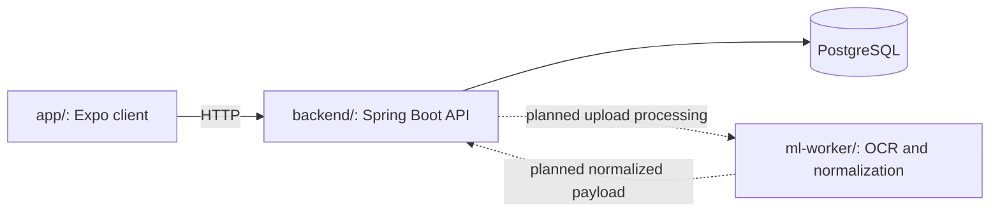

# Sentri

Sentri is a zero-budget cross-platform student companion for Army Institute of Technology.

[](.github/CONTRIBUTING.md)
[](LICENSE)

This repository is currently split into 3 working parts:

- `app/`: Expo React Native frontend for iPhone and Android
- `backend/`: Spring Boot API and timetable storage layer
- `ml-worker/`: Python OCR and timetable normalization worker

## Product Scope

### Current Focus

- timetable import from screenshots
- weekly Saturday prompt to refresh the next timetable
- clean home dashboard for now/next/today
- Myspace vault for saved screenshots, notes, and links
- calorie tracking shell
- hangout shell

## Why This Structure

### Design Philosophy

The app should stay simple and cheap to run:

- Expo keeps one mobile codebase for both platforms
- Spring Boot handles the main API and persistence
- Python is used only where it helps most: OCR and deterministic parsing

## Repository Architecture Map

This map helps new contributors quickly understand the codebase layout, see how the core components connect, and identify where to make changes before picking up an issue.

The mobile app calls the Spring Boot REST API over HTTP. The backend stores uploads and timetable entries in PostgreSQL. The Python worker provides OCR extraction and payload normalization, but the backend-to-worker processing step is not wired end to end yet.

Design specifications and contributor references live in `docs/`.



### Directory Breakdown

| Directory | Tech Stack | Role & Purpose | Where to Make Changes |
| :--- | :--- | :--- | :--- |
| [`app/`](app/) | Expo, React Native, JavaScript/JSX, TypeScript | Cross-platform mobile frontend | [Screens](app/src/screens/), [shared components](app/src/components/), [feature logic](app/src/features/), and [API/storage helpers](app/src/lib/). |
| [`backend/`](backend/) | Java 17, Spring Boot, PostgreSQL | Core API, data persistence, and orchestration | [Controllers](backend/src/main/java/com/sentri/backend/controller/), [services](backend/src/main/java/com/sentri/backend/service/), [entities](backend/src/main/java/com/sentri/backend/domain/), and [repositories](backend/src/main/java/com/sentri/backend/repository/). |
| [`ml-worker/`](ml-worker/) | Python 3.11, Pytest | OCR extraction and timetable normalization | [OCR and parsing pipeline](ml-worker/src/sentri_worker/), [worker tests](ml-worker/tests/), and [worker contributor guide](ml-worker/CONTRIBUTING.md). |
| [`docs/`](docs/) | Markdown | Architectural blueprints, guidelines, and specifications | System designs (HLD/LLD), domain logic specifications, animation guidelines, and onboarding guides. |

## Architecture

### Documentation & References

For detailed design specifications, consult the existing architecture documents:

- **System Architecture (HLD)**: [docs/system-design-hld.md](docs/system-design-hld.md)
- **Component Design (LLD)**: [docs/system-design-lld.md](docs/system-design-lld.md)
- **Contribution Workflow**: [.github/CONTRIBUTING.md](.github/CONTRIBUTING.md)
- **Home AI Logic**: [docs/ai-logic-home-timetable.md](docs/ai-logic-home-timetable.md)
- **Myspace AI Logic**: [docs/ai-logic-myspace.md](docs/ai-logic-myspace.md)
- **Myspace Indexing Pipeline**: [docs/myspace-indexing-pipeline.md](docs/myspace-indexing-pipeline.md)
- **Code of Conduct**: [.github/CODE_OF_CONDUCT.md](.github/CODE_OF_CONDUCT.md)
- **Security Policy**: [.github/SECURITY.md](.github/SECURITY.md)
- **Support Policy**: [.github/SUPPORT.md](.github/SUPPORT.md)

### Performance Optimizations

- on-demand tab mounting in the mobile shell
- shared persisted state utilities with cached storage reads
- deferred Myspace search filtering
- shared mobile HTTP client with request timeouts
- backend indexes, cacheable read paths, and read-only transactions

## Run Locally

### Prerequisites

- Node.js 16+ for frontend
- Java 17+ for backend
- Python 3.11+ for ML worker

### Frontend

```bash
cd app
npm start
```

### Backend

```bash
cd backend
mvn spring-boot:run
```

### OCR worker tests

```bash
cd ml-worker
python -m pip install -e ".[dev]"
pytest
```

The same worker test command runs in GitHub Actions for pull requests that touch `ml-worker` or the worker workflow.

## Notes

- The OCR worker now emits a payload shape that the Spring Boot backend can consume.
- The frontend is currently a polished shell for the main tabs and shared design system.
- The home flow now reflects the AIT reality that a fresh timetable arrives every Saturday for the next week.
- The Home upload action now opens the native image picker and creates a real timetable upload batch through Spring Boot.
- Full parser wiring still needs the backend worker step that turns the stored screenshot into parsed timetable entries.
